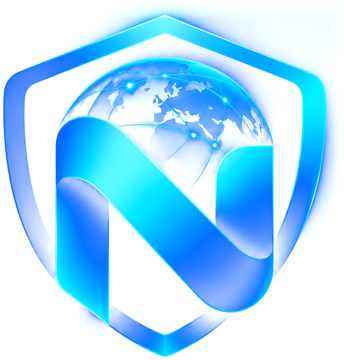

# Nexino VPN | نکسینو وی‌پی‌ان

**سریع، پایدار و بدون محدودیت حجم**

## دانلود

| سیستم‌عامل | فایل |
|---|---|
| اندروید | [دانلود APK آخرین نسخه](https://github.com/best4521/NexinoVPN/releases/latest) |
| ویندوز | [دانلود ZIP آخرین نسخه](https://github.com/best4521/NexinoVPN/releases/latest) |

همه‌ی نسخه‌ها و تغییرات هر نسخه در بخش [Releases](https://github.com/best4521/NexinoVPN/releases) است.

## امکانات

- 🌍 **مولتی‌لوکیشن:** سرور در کشورهای مختلف، با حالت «هوشمند» که خودکار سریع‌ترین سرور را پیدا می‌کند
- 🏮 **فانوس:** سرورهای ویژه‌ی پایدار برای شرایط سخت اینترنت
- ♾ **حجم نامحدود:** اشتراک‌ها فقط بر اساس زمان و تعداد دستگاه هستند
- 🖥 **ویندوز با حالت VPN کامل:** همه‌ی برنامه‌ها بدون تنظیم از VPN رد می‌شوند
- 🎁 **اشتراک تست رایگان** هنگام ثبت‌نام
- 📶 نمایش پینگ سرور متصل
- 🇮🇷 باز شدن مستقیم سایت‌های ایرانی بدون عبور از VPN
- 🔔 اطلاع‌رسانی‌ها داخل برنامه
- 🔄 به‌روزرسانی خودکار از داخل برنامه

## نصب روی اندروید

1. فایل `NexinoVPN-x.y.z.apk` را از بخش Releases دانلود کنید.
2. فایل را باز کنید و اگر گوشی پرسید، اجازه‌ی «نصب از منابع ناشناس» را بدهید.
3. اگر پیام **Google Play Protect** آمد، **Scan app** را بزنید (یا More details ← Install anyway).
   این پیام برای همه‌ی برنامه‌هایی می‌آید که از Google Play نصب نمی‌شوند و به معنی خطرناک بودن برنامه نیست.

## نصب روی ویندوز

1. فایل `NexinoVPN-x.y.z-windows.zip` را دانلود و از حالت فشرده خارج کنید.
2. فایل `NexinoVPN.exe` را اجرا کنید.
3. اگر Windows SmartScreen پیام داد، **More info** و بعد **Run anyway** را بزنید.
4. ویندوز برای حالت VPN کامل اجازه‌ی مدیر می‌خواهد؛ **Yes** را بزنید تا همه‌ی برنامه‌ها (مرورگر، تلگرام، بازی‌ها) از VPN رد شوند.

## اطمینان از اصل بودن فایل

کنار هر نسخه در بخش Releases، کد **SHA-256** فایل‌ها نوشته شده است. فایل دانلودشده باید دقیقاً همان کد را داشته باشد.

- ویندوز (PowerShell): `Get-FileHash .\NexinoVPN-1.0.10.apk -Algorithm SHA256`
- لینوکس / مک: `sha256sum NexinoVPN-1.0.10.apk`

فایل‌ها فقط از همین صفحه یا از سایت رسمی `nex.2928.ir` دانلود شوند.

## خرید اشتراک و پشتیبانی

خرید و تمدید اشتراک و پشتیبانی از طریق ربات تلگرام: **[@V2shop_bot](https://t.me/V2shop_bot)**

